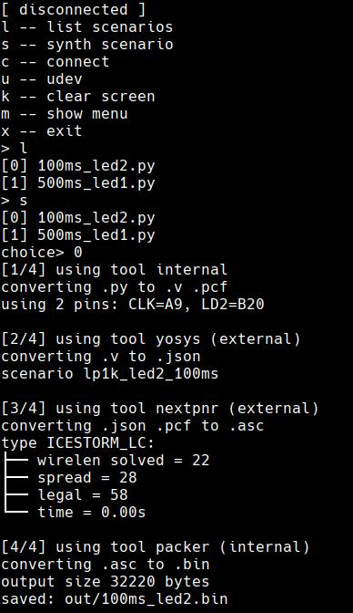
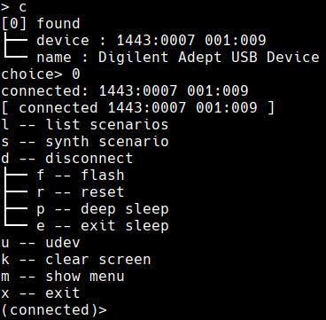
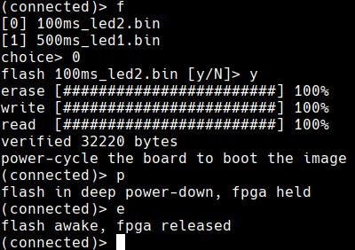

# host PC Linux Mint 22.2

## soft tests
**play.sh ** provides interactive menu to board control  

### synthesize a scenario

 

### connect device board

 

### flash and sleep cycle

 

## hard tests

 <video width="400" controls>
  <source src="blob/main/doc/lp1k-connect-flash-500ms_led1.mp4" type="video/mp4">
  Your browser does not support HTML video.
</video> 
